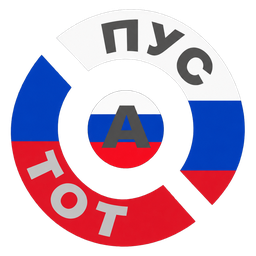

<p align="center"></p>

# Пустота · Pustota

*Pustota* is Russian for "void" or "emptiness". It's a light, keyboard-driven laptop system built on **Void Linux**. It's made for writing and for learning Russian, and to last a long time on battery. It's built for the Framework Laptop 13 Pro (Intel Core Ultra series 3, Panther Lake), and runs on most UEFI laptops.

| | |
| --- | --- |
| Base | Void Linux x86_64 glibc, **runit**, XBPS. **Linux 7.x** (`linux-mainline`: Void's newest kernel series, which the 13 Pro needs) |
| Disk | GPT: 1 GiB EFI, swap the size of the RAM (for hibernation), **XFS** root |
| Desktop | X11: **ratpoison** (each window fills the screen), **polybar** (the X11 counterpart of Waybar), **dmenu** menus, dunst notifications, slock screen lock, **X-терминал** (Pustota's own terminal: st with scrollback and a Plan 9 look) |
| Tools | **Midnight Commander** for files, **acme** and the rest of **Plan 9** (sam, rc, the plumber), Firefox, **LibreOffice** (British English and Russian, with spelling), mpv, zathura, ani-cli, clipboard history, night light, fastfetch (with the Пустота logo), `framework_tool` |
| Laptop | Wi-Fi and Bluetooth menus, PipeWire sound, brightness and volume keys, TLP and thermald, zram, suspend that turns into hibernation after two hours, low-battery hibernation, tap-to-click, ufw firewall, fingerprint for sudo |
| Russian | Constellation's kit: a 10,000-word drill, the AI tutor (Qwen3.6 35B-A3B, on the laptop), Piper voices, FSI/DLI/Peace Corps courses, *Между нами*, Wiktionary, audiobooks. English (UK) and Russian phonetic keyboard; Alt+Shift switches |
| Learning | `pustota-learn`: 22 lessons on how this system works, the **Pustota wiki** (Void explained page by page, in the manner of the Arch Wiki: runit, XBPS, xbps-src, elogind, boot, kernels, from-Arch …), `search` across both, `explain` (shows what a command would do, without running it), `doctor` (a read-only map of the running system), and Void's Handbook offline (`pustota-handbook`: in mc beside the wiki, as a PDF or in Firefox) |
| Installer | Automatic: five questions, one Yes/No, then the whole Void chroot install by itself |
| Packages | Void's repository, plus Pustota's own signed one: its packages, and what Void lacks (`x-terminal`, `ani-cli`, `ollama-bin`), built with xbps-src from `srcpkgs/` |

## Installing

1. Build the ISO (below), or download one, and write it to a USB stick (Ventoy works).
2. In the laptop's BIOS: **Secure Boot off**. Boot the stick in UEFI mode.
3. The stick logs in by itself and opens **nmtui**. Connect to Wi-Fi (or just quit if Ethernet is plugged in). The installer starts once it can reach Void's package repository.
4. Answer: the disk, a computer name, your username, your password (twice), the timezone (London is preselected), and whether to log in automatically.
5. Read the summary and choose **Erase and install**. That erases the whole chosen disk; it's the only point of no return.
6. Wait while it downloads about 2 GB from Void (LibreOffice is most of the extra), then reboot.

It boots straight into the desktop (or asks for your password, if you chose that). Press **Super+?** for the keys, or **Ctrl+Super+Space** for the menu.

What the installer does, step by step, is the manual chroot install from Void's handbook: partitions, `mkfs`, `xbps-install -r /mnt base-system …`, `xgenfstab -U`, locales, users, runit service links, `xbps-reconfigure -fa`, GRUB. After installing, `pustota-learn learn install` shows each command it ran, and `/var/log/pustota-install.log` holds them with their output. If anything fails, it stops with the reason on screen; Alt+F2 opens a shell to read the log.

## First things to try

```sh
pustota-learn                     # the lessons; start with architecture and install
pustota-learn doctor              # what is running, read-only
pustota-learn explain "sudo xbps-install -Su"
sudo pustota-content              # download the Russian material (choose the packs)
pustota-russian path              # the route from A1 to B2
```

| Keys | |
| --- | --- |
| Super+1…9, Super+Shift+1…9 | go to workstation, send the window there |
| Super+Tab | overview: pick a window or workstation |
| Super+q / f / r | close, full size, width 33→50→67→100% |
| Super+Space | run any program (dmenu) |
| Ctrl+Super+w / t / d / v / e / a / p | Firefox / terminal / Discord / video / files (mc) / ani-cli / VPN |
| Ctrl+Super+c / r / n / b / m | acme / Russian / Wi-Fi / Bluetooth / sound mixer |
| Ctrl+Super+Space | the Pustota menu (Russian, Learn, System, Power) |
| Super+x / z / Escape | lock / suspend / power menu |
| Super+Shift+s | screenshot of an area |
| Alt+Shift | English ↔ Russian |
| Ctrl+t then ? | all of ratpoison's own keys |

## Building the ISO

On Arch Linux (WSL2 works) or on Void, with about 10 GB free:

```sh
git clone https://github.com/factionparadox/Pustota && cd Pustota
bash build/build-iso.sh            # -> out/pustota-x86_64.iso and its .sha256
```

On Arch, it downloads Void's official root filesystem and checks it against Void's release key and a pinned SHA-256, then builds inside it. It needs no Docker and changes nothing on Arch beyond installing `curl minisign xz tar openssl`. Then it:

1. builds the packages Void lacks from `srcpkgs/` with Void's own xbps-src;
2. makes Pustota's three packages;
3. signs the repository with your key, `~/.config/pustota/repo-key.pem`, made on the first build. Back it up: installed systems trust it;
4. writes the ISO, its squashfs and initramfs compressed with **zstd at level 3**.

Nothing large is compiled (Ollama is repackaged from its official release), so it takes minutes, not hours. See [docs/BUILDING.md](docs/BUILDING.md).

**Publishing the repository**, so installed systems get updates with `sudo xbps-install -Su`:

```sh
bash build/publish-repo.sh         # uploads build/work/repo to the release "repo-x86_64" (needs gh auth login)
```

## Layout

```
build/       build-iso.sh (Arch or Void), make-iso.sh (inside Void), build-srcpkgs.sh, build-packages.sh,
             sign-repo.sh, publish-repo.sh, make-branding.py, Void's key
srcpkgs/     xbps-src templates for what Void lacks: x-terminal, ani-cli, ollama-bin
branding/    the Пустота roundel (the original and the sizes made from it)
installer/   pustota-installer.py and the live image's network setup
desktop/root the pustota-desktop package: /etc/pustota, /etc/skel, /usr/bin/pustota-*
learn/       pustota-learn and its lessons
russian/     the Russian kit (from Constellation), Ollama's runit service
packages.txt every Void package Pustota installs, grouped and explained
tests/       python3 -m unittest discover tests
```

## Status

This is version 0.1, written on 31 October 2026. **Nothing has been built or booted yet.**

- **Tested here:** 101 automated tests pass. They cover:
  - the templates, signing order, zstd level 3, and the fastfetch config and logo;
  - the installer's whole sequence against a fake system, from partitions to GRUB, plus every one of its decisions;
  - the Russian kit's downloader, checksums and tutor (Constellation's 37 tests, ported);
  - the menu and the learning tool;
  - the wiring: every file the build copies exists, every key runs an installed program, and every bar module is defined.
- **Checked against Void itself:** every package name was checked against void-packages, and `linux-mainline` is 7.3. The void-mklive options were read at the pinned commit, and the patch was applied to that exact file. The templates follow Void's conventions, checked against existing templates. Every distfile checksum was taken from the published checksum or from git at the pinned commit.
- **Not yet tested:**
  - the ISO build, including the first xbps-src run in ethereal mode;
  - XBPS reading the repository from a GitHub release;
  - booting on the 13 Pro (including whether polybar's battery `BAT1` and `intel_backlight` names match);
  - the real install;
  - suspend, hibernate and resume;
  - audio;
  - the tutor's speed with 32 GB of RAM.

  The ISO build reuses the route that built Archon/Cognoscenti's Void ISO successfully on the same Arch WSL builder.

Report what happens on real hardware, and `pustota-learn doctor` output, in an issue.

## Credits

- **Void Linux** and void-mklive: the base, the live image and the handbook this follows.
- **Archon/Cognoscenti**: the Void build route, the installer's safety design and the learning tool and lessons, rewritten here.
- **Constellation/Kirin**: the Russian kit, word list and content mirror.
- **plan9port, ratpoison, polybar, Midnight Commander, dmenu, Piper, Ollama, Qwen, Kiwix**: their authors.

Pustota is GPL-3.0. Every Void package keeps its own licence. The Russian material keeps its own: US government courses and LibriVox recordings are public domain, the word list is CC BY-SA 4.0, and *Между нами* is CC BY-NC-ND and is downloaded for your personal use only.
